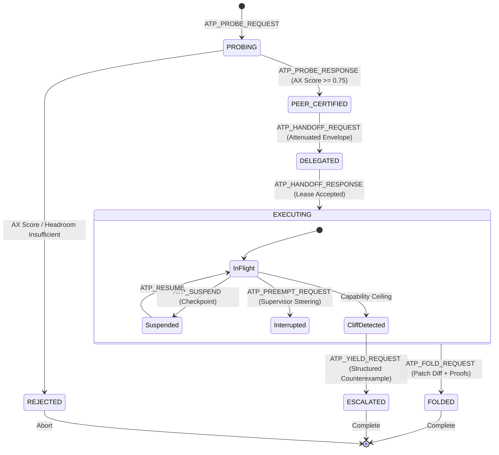

# Agentic Transfer Protocol (ATP)

[](https://github.com/dan-petty/atp/actions/workflows/ci.yml)
[](https://opensource.org/licenses/Apache-2.0)
[](https://www.python.org/)
[](#-architectural-invariant-compliance)

**Agentic Transfer Protocol (ATP)** is an open application-layer protocol and reference engine designed for **Cognitive State Migration, Attenuated Authority Delegation, and Closed-Loop Epistemic Synchronization** across heterogeneous autonomous systems.

---

## ⚡ Why ATP Exists

Modern agentic engineering has outgrown ad-hoc message passing:
- **HTTP** was designed for **Document Transfer**.
- **REST/gRPC** was designed for **Deterministic Data RPCs**.
- **MCP (Model Context Protocol)** was designed for **Tool & Resource Exposure**.

None of these protocols understand **Cognition, Intent, or Epistemic State**.

When multi-agent systems delegate tasks by dumping conversational transcripts or prompt strings across model boundaries, they suffer from four fundamental failure modes:
1. **Context Rot & Softmax Dilution**: Unstructured transcripts cause the Attention Dilution Index ($ADI$) to spike, drowning out critical invariants.
2. **Epistemic Amnesia**: Prior falsified hypotheses are discarded, inducing cyclic retry oscillations ($A \to B \to A$).
3. **Unbounded Ambient Authority**: Downstream subagents receive unattenuated credentials without hard budget leashes or tool boundaries.
4. **Silent Friction Absorption**: Agents silently hack around brittle interfaces rather than providing structured feedback.

**ATP solves this by standardizing the Epistemic State Envelope (ESE)**—packaging not what the agent *said*, but what the agent *knows, intends, and is constrained by*.

---

## 🏛️ The 5-Layer Protocol Architecture

```
+--------------------------------------------------------------------------+
| 5. Cognitive & Telos Layer (Goal, Positive Invariants, Negative Gates)   |
+--------------------------------------------------------------------------+
| 4. Epistemic State Layer (World Model, AST Symbol Graph, CEGIS Ledger)   |
+--------------------------------------------------------------------------+
| 3. Governance & Leash Layer (Attenuated UCAN Tokens, Budget Ceilings)    |
+--------------------------------------------------------------------------+
| 2. Execution Envelope Layer (Sandbox Profiles, eBPF Policies, Schemas)   |
+--------------------------------------------------------------------------+
| 1. Transport & Framing Layer (Async Streams, Out-of-Band Interrupts)     |
+--------------------------------------------------------------------------+
```

---

## 🔄 Protocol Lifecycle & State Machine



---

## 📦 The Epistemic State Envelope (ESE)

The unit of transfer in ATP is the **Epistemic State Envelope**. It replaces raw chat transcripts with a structured cognitive frame:

```json
{
  "$schema": "https://atp-spec.dev/schemas/v1/envelope.json",
  "atp_version": "1.0.0",
  "envelope_id": "9b1deb4d-3b7d-4bad-9bdd-2b0d7b3dcb6d",
  "traceparent": "00-4bf92f3577b34da6a3ce929d0e0e4736-00f067aa0ba902b7-01",
  "delegation_chain": {
    "issuer": "user:dan@example.com",
    "subject": "agent:lead-orchestrator",
    "capabilities": ["repo:read", "repo:write"],
    "proof": "ucan:eyJhbGciOiJFUzI1Nks..."
  },
  "budget_leash": {
    "token_limit": 16000,
    "max_cost_usd": 0.25,
    "max_tool_invocations": 10,
    "deadline_utc": "2026-09-24T22:00:00Z"
  },
  "telos": {
    "goal": "Refactor nested elif ladder in src/core/router.py to table-driven dispatch",
    "exit_criteria": [
      "pytest tests/test_router.py passes 100%",
      "ast_sentinel cyclomatic complexity M <= 4"
    ]
  },
  "invariant_contract": {
    "positive_invariants": ["preserve_http_semantics", "zero_test_regressions"],
    "negative_constraints": ["no_kwargs", "no_permissive_dicts"],
    "cegis_counterexamples": [
      {
        "input": "router.dispatch('/health')",
        "expected": "HTTP 200",
        "failing_actual": "HTTP 404",
        "rationale": "Regex boundary failure in initial draft"
      }
    ]
  },
  "workspace_context": {
    "repository": "dan-petty/devops-cli",
    "commit_base": "88d3063c685252f4e4a79ecfb92f1b0e890e698f",
    "working_patch": "diff --git a/src/core/router.py ...",
    "active_symbols": ["src/core/router.py::RouteDispatcher::dispatch"]
  },
  "compacted_reasoning_ledger": [
    {
      "hypotheses_evaluated": 2,
      "falsified": ["Dynamic eval() dispatch violates security invariant SEC001"],
      "active_approach": "Frozen dictionary dispatch with lambda handlers"
    }
  ]
}
```

---

## 🚀 Quick Start

### Installation

```bash
pip install atp
# Or using uv:
uv add atp
```

### CLI Inspection & Validation

```bash
# Validate an envelope against schema and Pydantic models
atp validate envelope.json

# Display a formatted cognitive budget and invariant summary
atp inspect envelope.json
```

### Python API Example

```python
from atp.protocol.models import (
    EpistemicEnvelope,
    BudgetLeash,
    Telos,
    InvariantContract,
    WorkspaceContext,
)
from atp.protocol.verbs import ATPSession

# 1. Initialize envelope with strict boundaries
envelope = EpistemicEnvelope(
    traceparent="00-4bf92f3577b34da6a3ce929d0e0e4736-00f067aa0ba902b7-01",
    budget_leash=BudgetLeash(
        token_limit=16000,
        max_cost_usd=0.25,
        max_tool_invocations=10,
    ),
    telos=Telos(
        goal="Eliminate cyclomatic complexity hotspot in dispatch logic",
        exit_criteria=["pytest tests/ passes", "McCabe M <= 4"],
    ),
    invariant_contract=InvariantContract(
        positive_invariants=["100% test pass"],
        negative_constraints=["no unconstrained **kwargs"],
    ),
    workspace_context=WorkspaceContext(
        repository="dan-petty/devops-cli",
        commit_base="88d3063c685252f4e4a79ecfb92f1b0e890e698f",
    ),
)

# 2. Spawn and execute session with budget enforcement
session = ATPSession(envelope)
session.transition_to("EXECUTING")
session.record_usage(tokens=1200, cost_usd=0.015, tools_called=2)

# 3. Fold structured epistemic result back upstream
result = session.fold(
    patch_diff="diff --git a/router.py ...",
    certified_invariants=["McCabe M <= 4", "zero regressions"],
)
print(f"Fold status: {result.status}, Tokens: {result.tokens_spent}")
```

### Rust Reference Implementation (`crates/atp`)

The Rust crate provides a high-assurance, zero-cost abstraction implementation featuring:
- **Compile-Time Type-State Transitions**: State transitions (`Idle` $\to$ `Executing` $\to$ `Folded`/`Suspended`/`Yielded`) enforced by the Rust type system with `PhantomData<State>`. Invalid state transitions cannot compile.
- **Negative Schema Boundaries**: `#[serde(deny_unknown_fields)]` rejects unexpected or hallucinated JSON fields at deserialization.
- **Async Length-Prefixed Stream Framing**: Tokio codec with 4-byte big-endian framing and a 16MB safety ceiling (`MAX_FRAME_SIZE_BYTES`).

```rust
use atp::{EpistemicEnvelope, Session, BudgetLeash, Telos, InvariantContract, WorkspaceContext};

#[tokio::main]
async fn main() -> Result<(), Box<dyn std::error::Error>> {
    // 1. Build epistemic envelope
    let envelope: EpistemicEnvelope = serde_json::from_str(r#"{ ... }"#)?;

    // 2. Start session (Idle -> Executing)
    let mut session = Session::new(envelope).begin_execution();

    // 3. Track resource consumption against leash
    session.record_usage(1200, 0.015, 2)?;

    // 4. Fold completed work into structured result (Executing -> Folded)
    let (payload, _folded_session) = session.fold(
        "diff --git a/router.py ...".to_string(),
        vec!["zero_regressions".to_string()],
    );
    println!("Folded successfully with tokens: {}", payload.tokens_spent);
    Ok(())
}
```

#### Rust CLI Execution

```bash
# Build and run Rust ATP CLI
cargo run -- validate envelope.json
cargo run -- inspect envelope.json
cargo run -- version
```

---

## 🛡️ Architectural Invariant Compliance

The ATP reference implementation strictly enforces and adheres to mechanical quality gates:
- **Strict Complexity & Nesting Limits**: All functions and methods certified at $M \le 6$ and block nesting depth $\le 3$ under `sentinel.py --preset strict`.
- **Negative Schema Boundaries**: All Pydantic models enforce `extra="forbid"`, rejecting undefined parameters.
- **Zero-Trust Egress**: Zero internal hostnames or RFC 1918 addresses in code, telemetry, or documentation.
- **100% Unit Test Pass & Coverage Floor**: $\ge 90\%$ test coverage with structural tuple equality checks.

---

## 📜 Specifications & Schemas

- [RFC 0001: ATP Core Specification](spec/v1/RFC-0001-CORE-SPECIFICATION.md)
- [Epistemic State Envelope JSON Schema](spec/schemas/v1/envelope.json)
- [Lifecycle Frames JSON Schema](spec/schemas/v1/lifecycle.json)

---

## 📄 License

Licensed under the [Apache License, Version 2.0](LICENSE).
