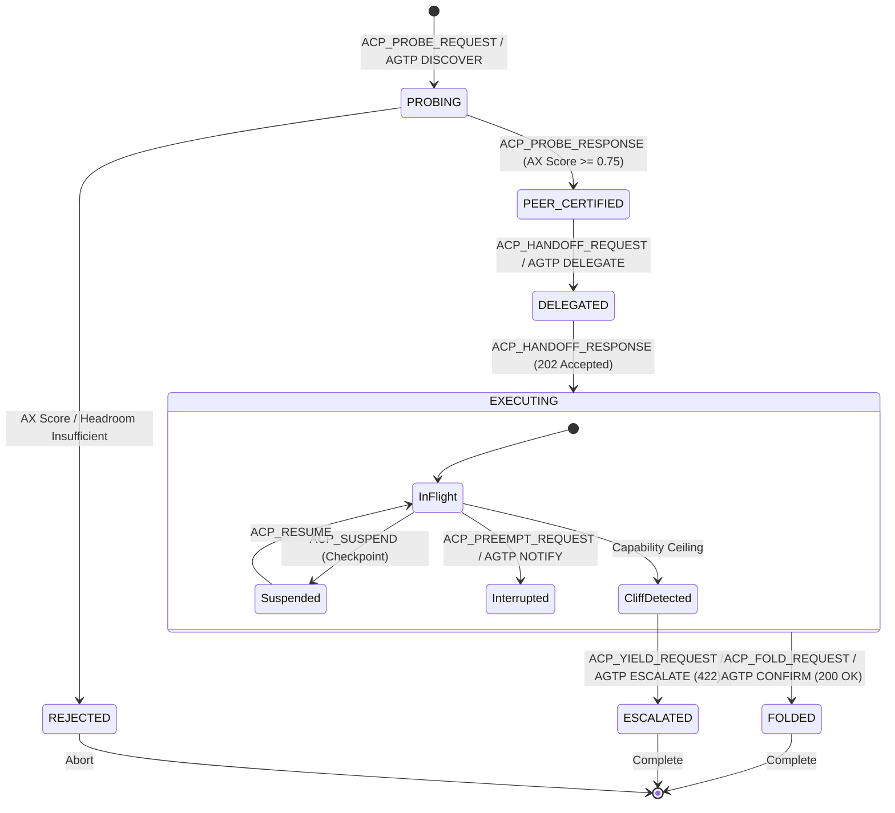

# Agentic Communication Protocol (ACP)

[](https://github.com/dan-petty/acp/actions/workflows/ci.yml)
[](https://opensource.org/licenses/Apache-2.0)
[](https://www.python.org/)
[](https://www.rust-lang.org/)
[](#-architectural-invariant-compliance)

**Agentic Communication Protocol (ACP)** is an open specification, high-assurance polyglot engine, and reference wire substrate designed for **Cognitive State Migration, Attenuated Authority Delegation, and Closed-Loop Epistemic Synchronization** across autonomous AI agent systems.

ACP serves two foundational roles in the emerging agent protocol stack:
1. **The Cognitive & Epistemic Substrate (Layer 5/6)**: Standardizes what agents *know, intend, and verify* via the **Epistemic State Envelope (ESE)**, Counterexample-Guided Invariant Contracts (CEGIS), defensive budget leashes, and Ed25519 authority attenuation.
2. **First-Class Reference Implementation of AGTP Wire Protocol (Layer 4/7)**: Provides full polyglot bindings for IETF **`draft-hood-independent-agtp`** (Agent Transfer Protocol by Chris Hood, Nomotic, Inc.), operating on IANA port **4480** with strict `Content-Length` framing and agent intent verbs (`DELEGATE`, `ESCALATE`, `CONFIRM`, `SUSPEND`, `DISCOVER`).

---

## ⚡ The Architectural Landscape

```
+--------------------------------------------------------------------------+
| 7. Local Tool Registration Layer: Model Context Protocol (MCP JSON-RPC)  |
+--------------------------------------------------------------------------+
| 5-6. Cognitive & Epistemic Layer: ACP (Epistemic Envelopes, CEGIS, Leash)|
+--------------------------------------------------------------------------+
| 4. Agent Application Wire Protocol: AGTP (draft-hood, Port 4480, agtp://)|
+--------------------------------------------------------------------------+
| 3. Internet Routing & Discovery: IETF draft-li-atp (_atp DNS SVCB, ATS)  |
+--------------------------------------------------------------------------+
```

As recognized in *`draft-hood-independent-agtp`*:
> *"AGTP is designed to support and carry higher-level agent frameworks (such as MCP, A2A, and ACP) as content types within its method invocations, rather than replacing them."*

While AGTP replaces HTTP for agent wire traffic, **ACP provides the mathematical cognitive contract (`application/agtp+json`)** that prevents context rot, amnesia retry loops, and vague error yields.

---

## 🏛️ The 5-Layer Protocol Architecture

```
+--------------------------------------------------------------------------+
| 5. Cognitive & Telos Layer (Goal, Positive Invariants, Negative Gates)   |
+--------------------------------------------------------------------------+
| 4. Epistemic State Layer (World Model, AST Symbol Graph, CEGIS Ledger)   |
+--------------------------------------------------------------------------+
| 3. Governance & Leash Layer (Attenuated Ed25519 Tokens, Budget Ceilings)  |
+--------------------------------------------------------------------------+
| 2. Execution Envelope Layer (Sandbox Profiles, eBPF Policies, Schemas)   |
+--------------------------------------------------------------------------+
| 1. Transport & Framing Layer (AGTP Wire Stream, UDS, In-Memory Duplex)   |
+--------------------------------------------------------------------------+
```

---

## 🔄 Protocol Verbs & Lifecycle State Machine



---

## 📦 The Epistemic State Envelope (ESE)

The unit of transfer in ACP is the **Epistemic State Envelope**. It replaces raw chat transcripts with a structured cognitive frame:

```json
{
  "$schema": "https://acp-spec.dev/schemas/v1/envelope.json",
  "acp_version": "1.0.0",
  "envelope_id": "9b1deb4d-3b7d-4bad-9bdd-2b0d7b3dcb6d",
  "traceparent": "00-4bf92f3577b34da6a3ce929d0e0e4736-00f067aa0ba902b7-01",
  "delegation_chain": {
    "issuer": "user:dan@example.com",
    "subject": "agent:lead-orchestrator",
    "capabilities": ["repo:read", "repo:write"],
    "proof": "a4f89b3c41de098734f1837920ab76219487cdef012984576391029384756102"
  },
  "budget_leash": {
    "token_limit": 16000,
    "max_cost_usd": 0.25,
    "max_tool_invocations": 10,
    "deadline_utc": "2026-09-24T22:00:00Z"
  },
  "telos": {
    "goal": "Refactor nested elif ladder in src/core/router.py to table-driven dispatch",
    "exit_criteria": [
      "pytest tests/test_router.py passes 100%",
      "ast_sentinel cyclomatic complexity M <= 4"
    ]
  },
  "invariant_contract": {
    "positive_invariants": ["preserve_http_semantics", "zero_test_regressions"],
    "negative_constraints": ["no_kwargs", "no_permissive_dicts"],
    "cegis_counterexamples": [
      {
        "input": "router.dispatch('/health')",
        "expected": "HTTP 200",
        "failing_actual": "HTTP 404",
        "rationale": "Regex boundary failure in initial draft"
      }
    ]
  },
  "workspace_context": {
    "repository": "dan-petty/acp",
    "commit_base": "88d3063c685252f4e4a79ecfb92f1b0e890e698f",
    "working_patch": "diff --git a/src/core/router.py ...",
    "active_symbols": ["src/core/router.py::RouteDispatcher::dispatch"]
  },
  "compacted_reasoning_ledger": [
    {
      "hypotheses_evaluated": 2,
      "falsified": ["Dynamic eval() dispatch violates security invariant SEC001"],
      "active_approach": "Frozen dictionary dispatch with lambda handlers"
    }
  ]
}
```

---

## 🚀 Quick Start

### Installation

```bash
# Python
pip install acp
# Or using uv:
uv add acp

# Rust
cargo add acp
```

### CLI Inspection & Validation

```bash
# Validate an envelope against JSON schema and Pydantic models
acp validate envelope.json

# Display formatted cognitive budget and invariant summary
acp inspect envelope.json

# Start Model Context Protocol (MCP) gateway over standard I/O
acp mcp
```

### Python AGTP Wire Transport Example

```python
from acp.protocol.transport import AGTPTransport
from acp.protocol.models import ProtocolFrame

# Connect to sandboxed worker over AGTP (Unix socket or TCP port 4480)
transport = await AGTPTransport.connect_unix("/tmp/agent.sock", target_uri="/v1/tasks/refactor")

# Send signed task delegation (AGTP DELEGATE method)
handoff_frame = ProtocolFrame(frame_type="ACP_HANDOFF_REQUEST", envelope=envelope)
await transport.send_frame(handoff_frame)

# Await structured confirmation (AGTP CONFIRM / FoldPayload)
response_frame = await transport.receive_frame()
print(f"Task result: {response_frame.fold_payload.status}")
```

### Rust Reference Implementation (`crates/acp`)

```rust
use acp::{EpistemicEnvelope, Session, BudgetLeash, Telos, InvariantContract, WorkspaceContext};
use acp::transport::agtp::{AgtpRequest, encode_agtp_request, parse_agtp_request};

#[tokio::main]
async fn main() -> Result<(), Box<dyn std::error::Error>> {
    // 1. Build epistemic envelope
    let envelope: EpistemicEnvelope = serde_json::from_str(r#"{ ... }"#)?;

    // 2. Start session (Idle -> Executing)
    let mut session = Session::new(envelope).begin_execution();
    session.record_usage(1200, 0.015, 2)?;

    // 3. Fold completed work into structured result
    let (payload, _folded) = session.fold(
        "diff --git a/router.py ...".to_string(),
        vec!["zero_regressions".to_string()],
    );
    println!("Folded successfully with tokens: {}", payload.tokens_spent);
    Ok(())
}
```

---

## 🎭 Dual-Agent Demonstration Exhibit

A complete, runnable dual-agent sandbox demonstrating cross-process task delegation, anti-amnesia navigation, CEGIS counterexample escalation, and defensive leash enforcement over AGTP wire framing:

```bash
python examples/dual_agent_sandbox/run_demo.py
```

See [`examples/dual_agent_sandbox/README.md`](examples/dual_agent_sandbox/README.md) for full architecture and sequence diagrams.

---

## 🛡️ Architectural Invariant Compliance

The ACP reference implementation strictly enforces:
- **Strict Complexity & Nesting Limits**: All functions and methods certified at $M \le 6$ and block nesting depth $\le 3$ under `sentinel.py --preset strict`.
- **Negative Schema Boundaries**: All Pydantic models enforce `extra="forbid"`, rejecting undefined parameters.
- **Zero-Trust Egress**: Zero internal hostnames or RFC 1918 addresses in code, telemetry, or documentation.
- **100% Unit Test Pass & Coverage Floor**: $\ge 90\%$ test coverage with structural tuple equality checks.

---

## 📜 Specifications & Schemas

- [RFC 0001: ACP Core Specification](spec/v1/RFC-0001-CORE-SPECIFICATION.md)
- [RFC 0002: AGTP Wire Protocol Bindings](spec/v1/RFC-0002-AGTP-WIRE-BINDINGS.md)
- [Epistemic State Envelope JSON Schema](spec/schemas/v1/envelope.json)
- [Lifecycle Frames JSON Schema](spec/schemas/v1/lifecycle.json)

---

## 📄 License

Licensed under the [Apache License, Version 2.0](LICENSE).
