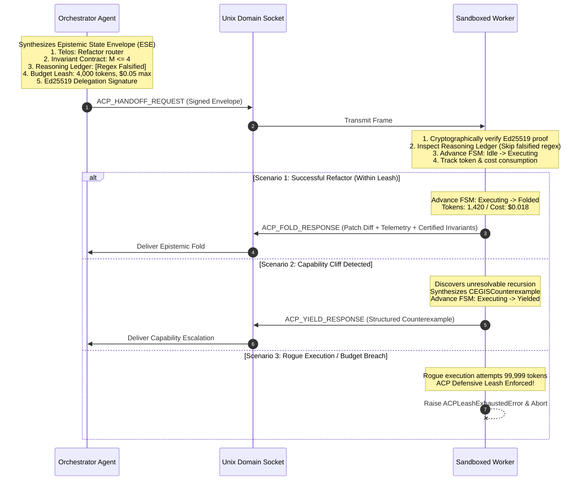

# Dual-Agent Sandbox Demonstration Exhibit

This exhibit demonstrates cross-process, asynchronous task delegation between an **Orchestrator Agent** and a **Sandboxed Worker Agent** using the **Agentic Communication Protocol (ACP)** over a Unix Domain Socket.

---

## 🏛️ Architecture & Protocol Flow



---

## ⚡ The 3 Scenarios Demonstrated

### 1. Clean Delegation & Epistemic Fold (Anti-Amnesia)
- **Problem**: In raw chat systems, when delegating to subagents, prior falsified attempts are forgotten. Subagents repeatedly try known bad approaches.
- **ACP Solution**: The `compacted_reasoning_ledger` carries previously falsified hypotheses (`["Dynamic regex compiler caused ReDoS vulnerability SEC-009"]`).
- **Outcome**: The Worker inspects the ledger, bypasses the dead end, chooses a frozen table dispatch approach, certifies $M \le 4$, and folds the result upstream in an `ACP_FOLD_RESPONSE` frame.

### 2. Capability Cliff & CEGIS Yield
- **Problem**: When a subagent fails in traditional architectures, it returns a vague conversational error (`"I couldn't do this"`).
- **ACP Solution**: The Worker constructs a formal **`CEGISCounterexample`**:
  $$\text{Counterexample} = \langle \text{Input}, \text{Expected}, \text{Actual}, \text{Rationale} \rangle$$
- **Outcome**: The Orchestrator receives precise failure parameters inside an `ACP_YIELD_RESPONSE` frame to guide its next inductive synthesis turn.

### 3. Defensive Budget Leash Breach Abort
- **Problem**: Rogue or looping agents burn excessive tokens and dollars without bound.
- **ACP Solution**: The `budget_leash` enforces immutable resource caps (tokens, USD cost, deadlines, tool invocations).
- **Outcome**: When simulated execution attempts 99,999 tokens against a 4,000 token leash, the runtime immediately raises `ACPLeashExhaustedError` and aborts.

---

## 🚀 Running the Exhibit

Run the complete demonstration script:

```bash
# Execute standalone runner
python examples/dual_agent_sandbox/run_demo.py
```

Or run the automated integration tests:

```bash
pytest tests/test_demo_e2e.py -v
```
