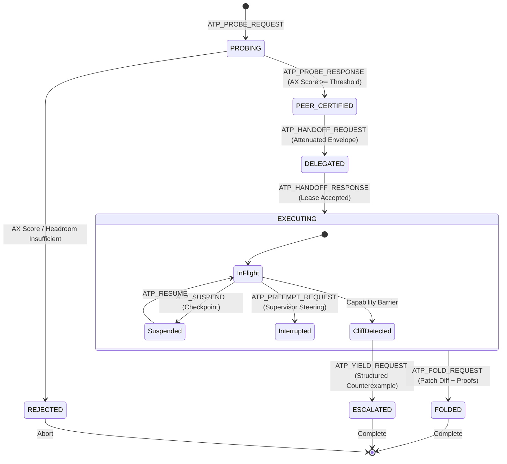

# RFC 0001: Agentic Transfer Protocol (ATP) Core Specification

- **Document Version**: `1.0.0-draft`
- **Status**: Standard Proposal
- **Date**: 2026-09-24
- **Authors**: Dan Petty & Antigravity (Google DeepMind)
- **Repository**: [`dan-petty/atp`](https://github.com/dan-petty/atp)

---

## 1. Abstract & Motivation

Existing application-layer protocols solve document retrieval (HTTP), data serialization (gRPC), or tool registration (MCP). However, when heterogeneous AI coding and reasoning agents collaborate, delegating tasks by dumping unstructured chat logs or raw prompt strings produces severe systemic failure modes:
1. **Context Rot & Softmax Dilution**: Attention Dilution Index ($ADI$) surges as irrelevant transcripts crowd out critical system instructions.
2. **Epistemic Amnesia**: Prior falsified hypotheses are discarded, forcing downstream agents into cyclic retry loops ($A \to B \to A$).
3. **Unbounded Authority**: Subagents receive ambient, unattenuated access without cryptographic budget leashes or tool boundaries.
4. **Silent Friction Absorption**: Agents hallucinate workarounds around brittle tool schemas instead of providing structured feedback.

The **Agentic Transfer Protocol (ATP)** provides a standardized, asynchronous, and cryptographically verifiable protocol for **Cognitive State Migration, Attenuated Authority Delegation, and Closed-Loop Epistemic Synchronization**.

---

## 2. The 5-Layer Architectural Stack

ATP establishes five operational layers:

```
+--------------------------------------------------------------------------+
| 5. Cognitive & Telos Layer (Goal, Positive Invariants, Negative Gates)   |
+--------------------------------------------------------------------------+
| 4. Epistemic State Layer (World Model, AST Symbol Graph, CEGIS Ledger)   |
+--------------------------------------------------------------------------+
| 3. Governance & Leash Layer (Attenuated UCAN Tokens, Budget Ceilings)    |
+--------------------------------------------------------------------------+
| 2. Execution Envelope Layer (Sandbox Profiles, eBPF Policies, Schemas)   |
+--------------------------------------------------------------------------+
| 1. Transport & Framing Layer (Async Streams, Out-of-Band Interrupts)     |
+--------------------------------------------------------------------------+
```

1. **Transport & Framing**: Provides multiplexed bidirectional byte streams (Unix Domain Sockets, HTTP/2, QUIC) with priority out-of-band preemption frames.
2. **Execution Envelope**: Attests and enforces kernel-level sandbox containment (`ISOLATION_ROOTLESS_CONTAINER`, `ISOLATION_PROCESS_GROUP`, `NETWORK_EGRESS_AIRGAPPED`).
3. **Governance & Leash**: Enforces cryptographic delegation chains and hard multi-dimensional resource bounds (tokens, dollars, deadlines, tool calls).
4. **Epistemic State**: Serializes what the agent *knows and has falsified*—including AST call graphs, git patches, and CEGIS negative constraints ($C^-$).
5. **Cognitive & Telos**: Defines the intent, verifiable exit criteria, and non-negotiable architectural invariant gates.

---

## 3. Protocol Verbs & Finite State Machine



### Verb Definitions:

- **`ATP_PROBE`**: Queries peer capabilities, context window headroom, model class, and Agent Experience score ($S_{\text{AX}}$).
- **`ATP_HANDOFF`**: Migrates an active problem-solving state along with cryptographic delegation proofs and accumulated negative constraints.
- **`ATP_SUSPEND` / `ATP_RESUME`**: Checkpoints an in-flight reasoning frame to content-addressed persistence, freeing runtime memory.
- **`ATP_PREEMPT`**: Out-of-band control signal to pause or abort invalid reasoning paths without waiting for turn completion.
- **`ATP_FOLD`**: Returns completed work upstream as an atomic patch diff, test certifications, token spend telemetry, and newly discovered invariants.
- **`ATP_YIELD`**: Escalates to a higher-capability model tier when a structural or capability ceiling is encountered.

---

## 4. The Epistemic State Envelope (ESE)

The unit of transfer in ATP is the **Epistemic State Envelope**. It replaces raw chat transcripts with a structured cognitive frame:

| Field | Type | Purpose |
|---|---|---|
| `atp_version` | String | Semantic version of protocol (`1.0.0`). |
| `envelope_id` | UUID | Unique message identifier. |
| `traceparent` | W3C String | Distributed trace parent for multi-agent observability. |
| `delegation_chain` | Object | Cryptographic proof (UCAN/Macaroon) with attenuated scopes. |
| `budget_leash` | Object | Hard caps: tokens, maximum USD cost, deadline UTC, tool call limit. |
| `telos` | Object | High-level goal and concrete falsifiable exit criteria. |
| `invariant_contract` | Object | Positive assertions, negative constraints, and CEGIS counterexamples. |
| `workspace_context` | Object | Target repository, base Git commit SHA, active patch, and modified symbols. |
| `compacted_reasoning_ledger` | Array | Compact record of evaluated hypotheses, falsified attempts, and current strategy. |

---

## 5. Security, Attenuation & Zero-Trust Invariants

1. **Negative Schema Boundaries**: All tool parameters and envelope contracts enforce `additionalProperties: false`. Hallucinated or unrecognized fields are rejected at the protocol boundary.
2. **Cryptographically Attenuated Delegation**: Downstream agents can only receive a subset of the caller's rights ($R_{\text{sub}} \subseteq R_{\text{parent}}$). Privilege escalation is mathematically impossible without the root private key.
3. **Process Group & Container Isolation**: Background tools spawned during ATP execution must run under POSIX process group isolation (`start_new_session=True`), preventing zombie grandchild processes.
4. **Zero Information Leakage**: Protocol frames must never leak private RFC 1918 hostnames, internal IPs, or cleartext credentials into persistent telemetry.
